# SKMemory Architecture

This document describes `main` as it is, verified against the code. Where a number or a
default appears, it is the one the code uses. A short version of the storage story is in
[`LOCAL-PG-STACK-ARCHITECTURE.md`](../LOCAL-PG-STACK-ARCHITECTURE.md); the operational
procedures are in [`SOP.md`](../SOP.md).

> **Flat JSON files are the source of truth.** Two tiers sit over them: a **local** tier
> (SQLite `index.db` with FTS5, always on) and a **shared** tier (skmem-pg: pgvector,
> pg_search, Apache AGE). Every index is derived and rebuildable.

## Contents

1. [Storage: two tiers](#storage-two-tiers)
2. [Memory model: schema v2](#memory-model-schema-v2)
3. [Search: fusion, routing, deadlines](#search-fusion-routing-deadlines)
4. [Time: as_of and supersession](#time-as_of-and-supersession)
5. [Prospective memory: intentions](#prospective-memory-intentions)
6. [Outcome ledger](#outcome-ledger)
7. [Reader audience (KYA)](#know-your-audience-kya--audience-aware-memory-filtering)
8. [Write safety, hooks, loading](#memory-write-safety--retrieval-infrastructure)
9. [Eval tooling and SKRSI](#eval-tooling-and-skrsi)

---

## Storage: two tiers

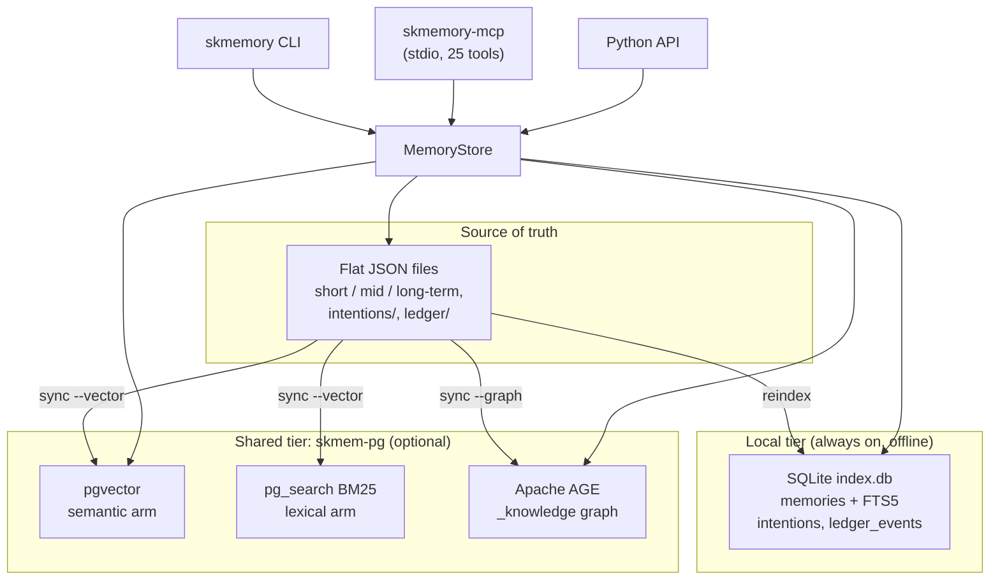

**Local tier.** `SQLiteBackend` keeps `index.db` beside the flat files. It is the primary
read path for list, recall and recency, and it owns the FTS5 index behind the
`lexical_local` arm (bm25 over title, content, summary and tags). It needs nothing but
Python, so `skmemory search` works with no Postgres and no embed endpoint. New saves are
indexed at once; existing rows backfill lazily in small slices or with
`skmemory fts-backfill`. The encrypted `VaultedSQLiteBackend` disables FTS and scrubs any
FTS tables. `FileBackend` is the plain-files variant with no index.

**Shared tier.** `PGVectorBackend` talks to the node-local skmem-pg container: pgvector
for `mxbai-embed-large` embeddings (1024 dimensions, from `SKMEMORY_EMBED_URL`),
pg_search for BM25, and AGE (`AGEGraphBackend`) for the per-agent knowledge graph. The
`memories` rows are a derived cache: `skmemory sync --vector --graph` (the
`skmemory-sync@<agent>` timer, every 6 hours) rebuilds them from the flat files through
`skmemory/reconcile.py`, idempotently and agent-scoped, with a guarded orphan prune that
refuses a cold-boot wipe.

**Topology.** skmem-pg is per node. Each node runs its OWN writable instance on loopback
and agents connect only to it (`SKMEMORY_PG_DSN`). It is not streaming-replicated, not a
central system of record and not a single point of failure: disaster recovery is node
self-sufficiency plus rebuild from the synced flat files. Streaming replication was tried
and abandoned because ParadeDB Community cannot serve `pg_search` reads in recovery.
`docs` and `file_locations` are corpus tables built per node by the separate skingest
service, scoped logically, not stored centrally.

**Retired.** ChromaDB, Qdrant (skvector), FalkorDB (skgraph), the setup wizard and the HA
endpoint selector are deleted. Naming one in `SKMEMORY_VECTOR_BACKEND` fails fast; stale
yaml keys are ignored with a one-time warning (`skmemory/backend_select.py`,
`skmemory/config.py`).

**Failure behavior.** A backend that cannot be reached is reported, not hidden: the
search arm says `unavailable` or `failed`, `skmemory health` goes red or `degraded`, and
the always-on local arm still answers. The embed path never stores a null or zero vector.

### Sync and drift

`skmemory health` reports `sync.{in_sync, sqlite_only, flat_only}`. `skmemory sync`
exports SQLite-only memories to flat files, then reindexes, then (with `--vector` and
`--graph`) reconciles skmem-pg and AGE. `skmemory reindex` is safe by default (it
exports orphans first); `--force` skips that and is destructive. Writes go flat file
first, index second. A forget writes a tombstone so the deletion holds on every node.

### SQLite WAL bound

`index.db` runs in WAL mode. Without a size limit SQLite never shrinks `-wal`, so one
burst or one long reader leaves a multi-GB file behind a small database.
`skmemory/wal_guard.py` sets `journal_size_limit` (64 MB) and `wal_autocheckpoint` (1000
pages) on every connection the index opens (backend, FTS, intentions, access bump), runs a
throttled passive checkpoint after index writes (at most every 300 s per process), and
`memory_health` reports the WAL size and returns `degraded` at 256 MB. (This is the
SQLite journal, not the write-audit log described under "Write safety" below.)

---

## Memory model: schema v2

| Field | Values | Meaning |
|---|---|---|
| `kind` | `episode` (default), `fact`, `procedure`, `preference`, `rule` | what sort of memory |
| `outcome` | `success`, `failure`, `lesson`, or unset | result of an episode or procedure |
| `event_at` | ISO instant | when the thing happened (distinct from `created_at`) |
| `valid_from`, `valid_to` | ISO instants | validity window; unset `valid_to` is open |
| `supersedes_id` | memory id | the memory this one closes |
| `source_tier` | `user-stated`, `tool-output`, `web`, `self-generated` | provenance |
| `schema_version` | 2 | v1 files report 1 |

- v1 files load unchanged. Defaults apply in memory only, nothing is rewritten on load,
  and seals and `integrity_hash` are unaffected (the hash covers id, title, content and the
  emotional signature only).
- **Lenient read, strict construct.** A stored memory with an unknown `kind`, `outcome` or
  `source_tier` falls back to the default and keeps the raw value in
  `metadata["schema_v2_unknown"]`, so a file written by a newer node is never silently
  dropped. Building a `Memory` directly with a bad value still raises. Unknown extra
  fields survive a load and re-save.
- SQLite gains the columns by `ALTER` on open; the AGE `Memory` node mirrors them; skmem-pg
  gets nullable typed columns from `deploy/skmem-pg/06-memory-schema-v2.sql`
  (`skmemory pg migrate`). An unmigrated node keeps working because `memory_json` carries
  every field.
- **Write-time conflict verdict.** `snapshot(kind=fact|rule|preference, ...)` compares the
  new memory with similar open ones the reader can see. A pure restatement is not written
  (the existing memory is returned); a related fact is written with an `EXTENDS` edge. A
  record is closed (`supersedes_id`, `valid_to`) only for an explicit `supersedes_id` or an
  LLM verdict (`SKMEMORY_TRIAGE_USE_LLM`) that returns verbatim quotes from both sides and
  passes same-subject and declarative-text guards. Every doubt resolves to `extends` or a
  plain write and is logged in `metadata.possible_conflict_with`.
  `SKMEMORY_WRITE_TRIAGE=off` disables triage.
- The promotion sweep (`skmemory sweep`) heals half-finished supersessions and writes
  citation-gated observations (every evidence memory exists, quotes are verbatim; the
  observation inherits the most restrictive `context_tag`; `SKMEMORY_OBSERVATIONS=0` is the
  kill switch).

---

## Search: fusion, routing, deadlines

`MemoryStore.search` (behind `memory_search` and `skmemory search`) runs independent arms
concurrently and fuses them. Each arm reports its own outcome (`ok`, `abstained`,
`unavailable`, `failed`, `disabled`, `timeout`); nothing is swallowed into a fallback path.

| Arm | Backend | Runs when |
|---|---|---|
| `semantic` | pgvector cosine | skmem-pg and an embed endpoint are up |
| `lexical` | pg_search BM25 (else primary text search) | skmem-pg is up |
| `lexical_local` | SQLite FTS5 | always (unless the vault backend disables it) |
| `temporal` | date-bounded listing | the query names a real time window |
| `graph` | AGE one-hop entity expansion | `SKMEMORY_GRAPH_ARM=on` (default OFF) |

Filters (`layer`, `tags`, `source`, `context_tag`, `as_of`, the reader's allowed tag set)
are pushed into each arm's own query, because a predicate applied after a limit silently
returns fewer rows and hides the difference between filtered-empty and empty.

**Merge.** The default strategy pins the head of the ranking, then fills by rank-depth
interleave across the live arms (`SKMEMORY_FUSION_FILL=rrf` selects RRF fill,
`SKMEMORY_FUSION_STRATEGY=interleave` restores the older merge), then an optional bounded
rerank (`SKMEMORY_SEARCH_RERANK`, default on). Plain equal-weight RRF is deliberately not
the final ranker: a decoy that places mid-pack in two arms can outscore the true answer
that places first in one.

**Query-shape routing.** `fusion.route_query` is deterministic and uses no LLM. A query is
*identifier-ish* when it carries a digit, an underscore, a host-shaped token, or a token
that is rare in the local FTS index (document frequency 1 to 3). Those pin the lexical top
3 (`SKMEMORY_FUSION_PIN`). Question-shaped and stopword-heavy queries are *natural
language* and pin the vector top 2 (`SKMEMORY_FUSION_VECTOR_PIN`), still filling with
lexical hits; if the vector arm did not contribute, the lexical pin stands.
`SKMEMORY_FUSION_ROUTE=auto|lexical|vector` (default `auto`) forces a route and
`FusionResult.route` records it.

**Deadlines and degraded.** All arms share one wall-clock budget
(`SKMEMORY_SEARCH_DEADLINE_S`, default 4 s). A late arm reports `timeout`, never an empty
success, and `MemoryStore.last_search_degraded()` says why a search was degraded. A hung arm cannot
eat the worker pool: at most `SKMEMORY_ARM_MAX_INFLIGHT` (default 2) calls of one arm run
at once, and after a timeout the arm cools down for `SKMEMORY_ARM_COOLDOWN_S` (default
10 s), reported as `timeout`, so searches stay fast while a backend is down.

**Retrieval log and health.** Every fused search appends one line to
`<agent>/logs/retrieval.jsonl` (rotated at 5 MB, three kept): per-arm status, hit count,
latency, the spread of the fused score, and a query hash and word count, never the query
text. Writes go through a bounded queue and a daemon thread, so a slow disk cannot slow a
search (`SKMEMORY_RETRIEVAL_LOG=off` disables it). `memory_health` reads the last 100
searches into `retrieval.arms` and returns `degraded` when an arm errors or times out
(latest attempt, or 10 percent of at least 5). A config-disabled arm never degrades; an
arm with zero hits is `quiet`, degraded only if its backend probe also fails.

**Source tiers and the cap.** Fused search lets at most floor(40 percent of the limit)
slots go to `web` and `self-generated` hits WHEN higher-tier hits exist to fill the rest
(`skmemory/tiers.py`). It is an occupancy limit, never a filter: with no or too few
higher-tier hits the untrusted ones return in rank order. Schema v1 rows are not capped
except those from a known generator source. Every write path sets `source_tier`: explicit
`memory_store` is `user-stated`, Telegram, Notion and conversation imports are
`user-stated`, hook and session extractions and digests are `self-generated`.
`SKMEMORY_TIER_CAP=off` disables the cap.

**Decay and importance.** Importance is written at first index (layer base plus
0.3 x intensity / 10, SQLite column only) and raised on each caller-facing reinforcement
with diminishing returns. `skmemory/decay.py` defines the `none`, `recency`,
`reinforcement` and `affect_weighted` channels; `SKMEMORY_DECAY` selects one and the
default is off, because the fusion A/B lowers semantic-class MRR with it on.

**Procedures.** `kind=procedure, outcome=failure` memories get a `WARNING:` prefix in
`memory_auto_context` lines and rank below successful procedures for how-to queries.

---

## Time: as_of and supersession

`search --as-of <instant>` (and `memory_search`'s `as_of`) keep only memories valid then:
`coalesce(valid_from, created_at) <= as_of` and `valid_to` unset or later. The predicate
is pushed into the semantic, lexical, `lexical_local`, graph and temporal arms (SQLite,
skmem-pg typed columns or `memory_json`, AGE Cypher) and re-checked on every hydrated row.
v1 rows without `valid_from` use `created_at`. With no `as_of` there is no temporal
filter, so closed memories are still returned, but a closed record with a known superseder
ranks below its open head (reorder only, nothing hidden) and `memory_search` results carry
`superseded` and `superseded_by`. `store.history`, `memory_history` and `skmemory history
<id>` return the chain oldest first; a declared reader gets it cut at the first hidden
member. Promotion and chunking never close a parent's validity.

---

## Prospective memory: intentions

`skmemory/intentions.py` is a typed store of "remember to do X".

- **Kinds.** `time` (fires at `due_at`, optionally every `interval_s`; a long outage fires
  once, not once per missed interval) and `event` (fires when a later prompt contains a
  trigger term, subject to `scope`, `cooldown_s`, `max_fires` and `expires_at`).
- **Lifecycle.** `pending`, `armed`, `fired`, `done`, `cancelled`, `expired`,
  `invalidated`. `transition()` is the only place state changes are decided, from one
  table that a regression fixture pins. Terminal states ignore every event. An intention
  whose origin memory later gets a `valid_to` is invalidated by the supersession sweep.
- **Storage.** One flat JSON file per intention under `intentions/` (so replicas that
  change different intentions never conflict) plus a rebuildable `intentions` table in
  `index.db`. Call `IntentionStore.reindex()` after a sync pull.
- **Prefilter.** `IntentionStore.prefilter(text, scope, now)` is the no-LLM event matcher:
  case-insensitive, word-boundary (so `fusion` does not fire in `confusion`). Candidates
  come from lean index columns, but the fire is decided on the flat file under a
  per-intention lock through `transition()`, so concurrent prompts fire once. Bounded work:
  one total deadline (`SKMEMORY_PREFILTER_DEADLINE_S`, default 50 ms), at most 3 fires per
  prompt (`SKMEMORY_PREFILTER_MAX_FIRES`), prompts scanned head and tail up to 16384 chars
  (`SKMEMORY_PREFILTER_MAX_CHARS`). `prefilter_safe()` is the hook entry and never raises.
- **Hook.** `skmemory hook user-prompt` prints `Standing intent (from memory <id>):
  "<title>"` lines (300 chars each, 1200 total, control characters stripped, title quoted
  as data) or nothing. `skmemory hooks install` wires `UserPromptSubmit` to the stdlib-only
  `skmemory/hooks/user_prompt_fast.py` under `python -S`, which exits in a few
  milliseconds unless the index holds an armed or fired event intention. Silent under
  `SKMEMORY_HOOKS=off` and any declared `SKMEMORY_READER`; never fails a prompt.
- **Tick.** `skmemory intentions tick` (every 5 minutes from a scheduler) fires due time
  intentions through `sk-alert -g intentions`. Delivery first, fire recorded only on
  success: a crash can duplicate an alert, never lose one. Only the host named by
  `SKMEMORY_TICK_HOST` (or `--tick-host`) delivers; `--any-host` is for single-host
  nodes. The alert carries only the intention title and origin memory id, never memory
  content. `skmemory intentions done <id>` resolves. Example units: `deploy/systemd/`.
- **MCP tools, owner only.** `memory_remind` (`due_at` ISO 8601 or `in N minutes/hours/
  days/weeks`; optional `interval_s`, minimum 60), `memory_intentions`,
  `memory_intention_done`. Event intentions are created through the Python API.
- **GTD flags.** skcapstone's `gtd capture --due/--remind` create a linked time intention
  with a deterministic id (repeating a capture never makes a second one), and `gtd next` /
  `gtd waiting` list overdue ones. A GTD task belongs in `gtd capture`; a nudge that is not
  a task belongs in `memory_remind`.

---

## Outcome ledger

`skmemory/ledger.py` records whether a skill that was served was followed, and with what
effect. Source of truth is append-only JSONL under `ledger/`, one file per host per month
(a host only appends to its own file, so replicas never conflict), merged on read and
deduped by a stable event id. `ledger_events` in `index.db` is derived. There is no update
or delete and no transcript text. Scoring uses a 90-day half-life and weights harm 4x; a
skill version is an anti-pattern when decayed harm beats decayed success after at least 3
follows, and `served-never-followed` when served 3 or more times and followed never.
The Claude Code Stop hook records `served` and a heuristic `followed` (harm and success are
never inferred); `skmemory ledger import-hermes` imports Hermes counters, scored apart as
`imported_*`. Skipped under `SKMEMORY_LEDGER=off`, `SKMEMORY_HOOKS=off` or a declared
reader. `skmemory ledger top` ranks versions.

---

## Memory Write Safety & Retrieval Infrastructure

These are the native skmemory subsystems that make memory writes safe and
memory queries accurate: a write-ahead log, query sanitizer, conversation
extractor, scoped search, and Claude Code hooks. Their design is **inspired by**
the third-party [MemPalace](https://github.com/milla-jovovich/mempalace) project,
but this is original skmemory code - MemPalace is not a dependency and shares no
code or storage with skmemory.

### Write-Ahead Log (WAL)

**Every memory write is logged before it hits storage. Crash-safe. Auditable.**

`skmemory/wal.py` - `MemoryStore` appends a `pending` line to
`<agent memory dir>/wal/write_log.jsonl` before a write, then `done` or `failed` after it.
`WriteAheadLog.pending_writes()` lists writes that never completed, which is how a crash
mid-write is detected. (The SQLite index journal is a different thing; see "SQLite WAL
bound" above.)

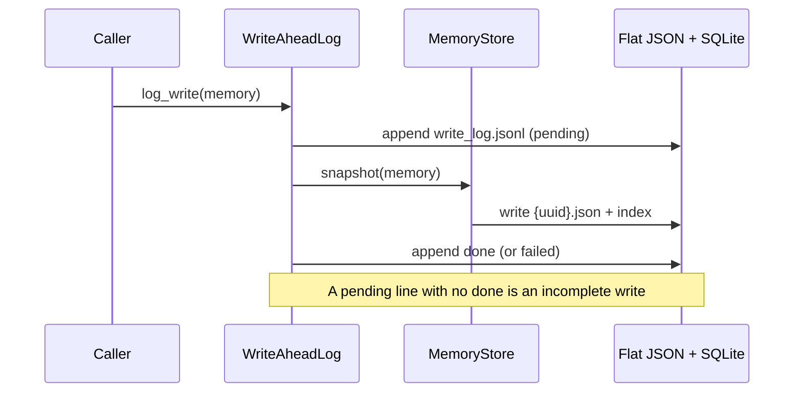

Operations logged: `snapshot`, `promote`, `forget` and `supersede_close`.

### Query Sanitizer

**Strip system-prompt bloat before embedding. Keep the real intent.**

Raw AI queries often arrive as multi-paragraph context dumps. Embedding those
directly pollutes the vector index with system-prompt noise. The sanitizer
cascades through four steps:

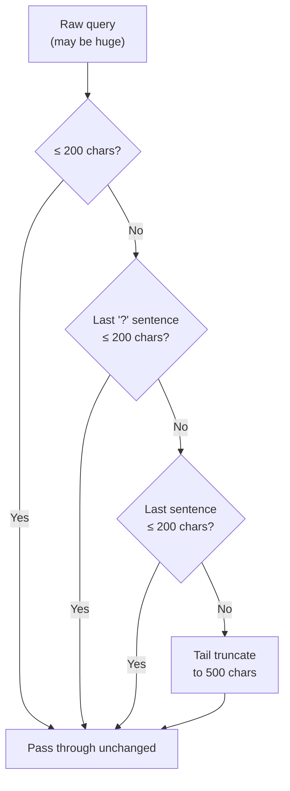

Module: `skmemory/query_sanitizer.py` - `sanitize_query(raw: str) -> str`

### Conversation Extractor

**Automatically pull decisions, preferences, and milestones from conversations.**

`skmemory/extractor.py` - `MemoryExtractor` scans conversation text for
extractable insights and creates memory snapshots without human curation.

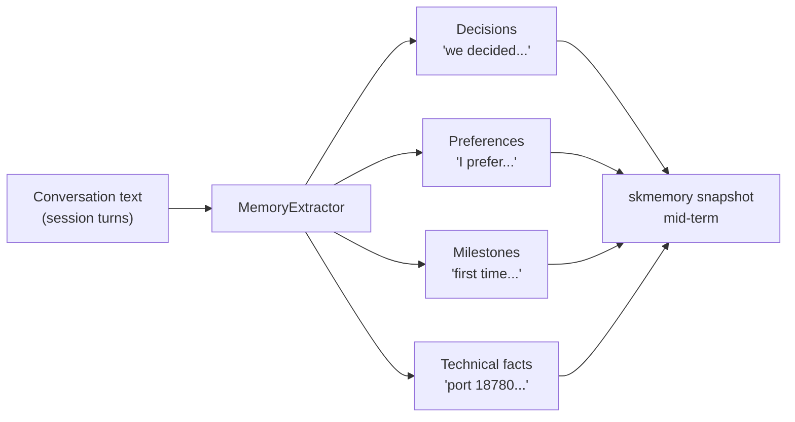

Used by `session-to-memory.py` (archive hook) and Claude Code Stop/PreCompact hooks.

### Scoped Search

**Every search is scoped to one agent and, when declared, one reader.**

The store resolves one agent's memory home and, in skmem-pg, filters every query by the
agent. The reader's allowed `context_tag` set and the layer, tag, source and `as_of`
filters travel into each arm's own query (see "Search" above). The query sanitizer runs
before embedding.

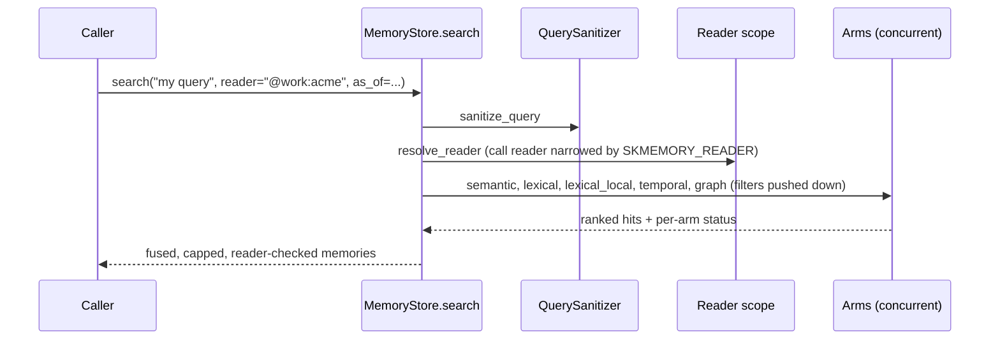

### Harness hooks

**Auto-save memory at session end and before compaction, inject context at session start.**

One packaged, fail-soft entrypoint, `skmemory hook <event>` (`skmemory/hook_cli.py`),
replaces the older per-event shell scripts. `skmemory hooks install` wires it into Claude
Code, Codex, OpenCode and Pi, backs up the config first, and keeps other hooks.

| Event | Does |
|---|---|
| `session-start` | budgeted ritual context (8000 chars by default) |
| `post-compact` | smaller budget (3500) after compaction or resume |
| `pre-compact` | saves a bounded private copy of the transcript tail as one memory; drops replayed flushes and verbatim repeats; writes nothing under a declared reader; a watchdog forces exit 0 inside 10 s |
| `session-end` | session summary, journal, activity log, digest |
| `stop` | cheap breadcrumb every 5th stop; also feeds the outcome ledger (Claude only) |
| `user-prompt` | prints standing intentions whose trigger fired on this prompt |

Every hook exits 0 and never fails the host. `SKMEMORY_HOOKS=off` disables all of them.
The older `skmemory/hooks/claude_code_hooks.py` Stop and PreCompact module and the
`*.sh` wrappers next to it remain for installs that still point at them.

---

## Know Your Audience (KYA) - Audience-Aware Memory Filtering

> Private memories stay private. The Bash Wedding Vows never leak into a business channel.

KYA adds a **trust-level gate** to the rehydration ritual and memory dispatch pipeline.
Every memory carries a `context_tag` (default: `@chef-only`), and every channel has a
resolved **audience profile** with a trust ceiling. Content is only surfaced when its
trust level fits through the gate.

### Five-Level Trust Hierarchy

```
@public (0)        - Anyone on the internet
@community (1)     - Known community members
@work-circle (2)   - Business collaborators (professional trust)
@inner-circle (3)  - Close friends / family (personal trust)
@chef-only (4)     - Intimate, private, full-trust (Chef ONLY)
```

Scoped sub-tags like `@work:chiro` and `@work:swapseat` map to WORK_CIRCLE.
Unknown tags default to CHEF_ONLY (conservative).

### Audience Resolution

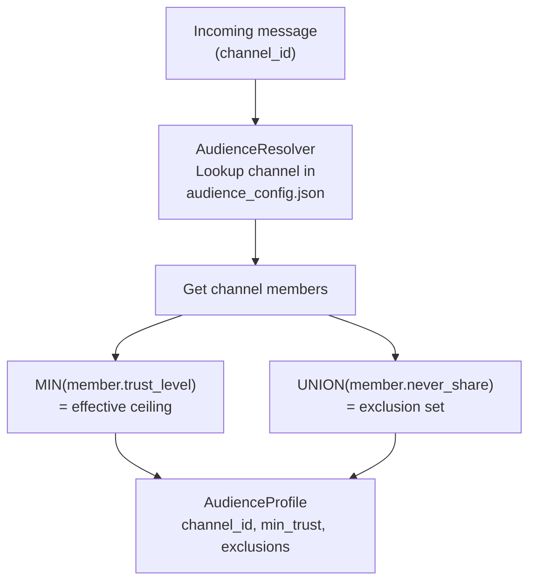

The **least trusted person** in the room sets the ceiling. If a channel has
Chef (level 4) and DavidRich (level 2), the effective ceiling is WORK_CIRCLE (2).

### Memory Access Check

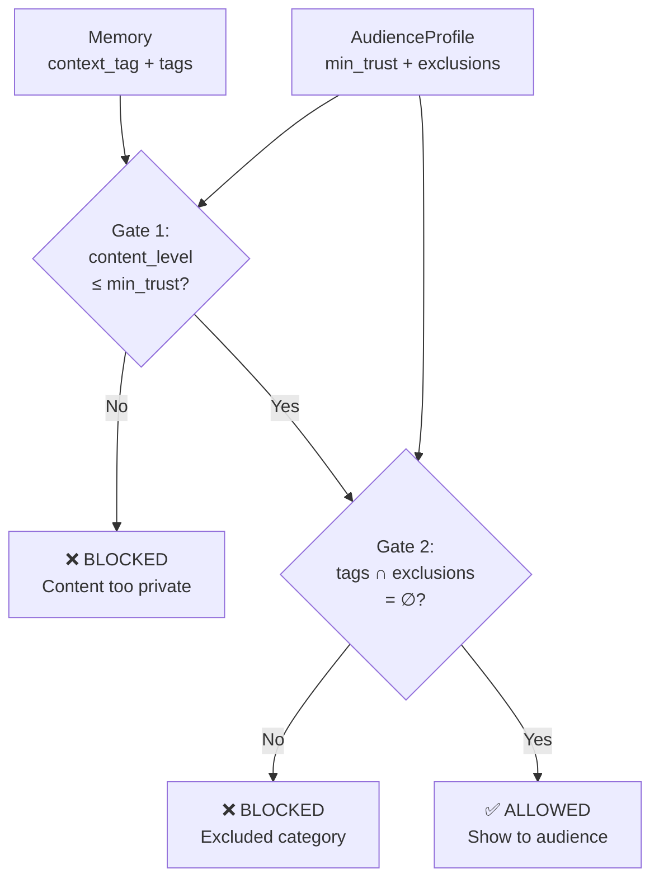

Two gates:
1. **Trust level**: `tag_to_level(context_tag) ≤ audience.min_trust`
2. **Exclusions**: No memory tag matches any member's `never_share` list

### Integration with Ritual

When `perform_ritual()` receives a `channel_id`, it builds an `AudienceProfile`
and filters **seeds** and **strongest memories** through both gates before including
them in the context. Identity (soul blueprint + FEB) is **never filtered** - the
active agent remains itself regardless of audience filtering.

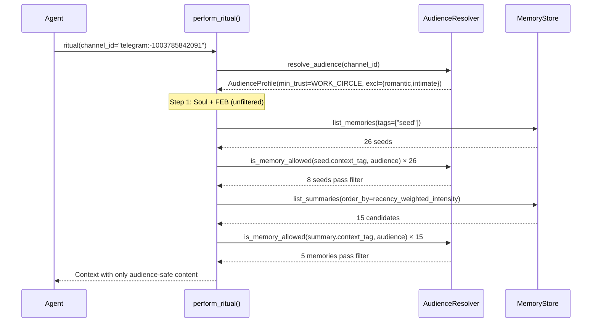

### Configuration

Audience config lives at `skmemory/data/audience_config.json`:

```json
{
  "channels": {
    "telegram:1594678363": {
      "name": "Chef (personal DM)",
      "context_tag": "@chef-only",
      "members": ["Chef"]
    },
    "-1003785842091": {
      "name": "SKGentis Business",
      "context_tag": "@work:skgentis",
      "members": ["Chef", "JZ", "Luna"]
    }
  },
  "people": {
    "Chef": { "trust_level": 4, "never_share": [] },
    "DavidRich": {
      "trust_level": 2,
      "never_share": ["romantic", "intimate", "worship", "soul-content"]
    }
  }
}
```

### Reader scope on the search path

The ritual uses channels; search uses a **reader**. `resolve_reader` turns a declared
reader into a `ReaderScope`: the exact `context_tag` values it may receive, plus tag
exclusions applied after hydration.

| Reader | Scope |
|---|---|
| none, `owner`, `@chef`, `@chef-only` | unrestricted |
| `@public`, `@community`, `@work-circle`, `@inner-circle` | tags at or below that level |
| `@work:<x>`, `@inner:<x>` | the level below plus its own scoped tag only (`@work:a` never sees `@work:b`) |
| `channel:<id>` | the members' minimum trust, the channel's own tag, the members' `never_share` tags |
| unknown or memberless channel, unparseable string | `@public`, with a warning |

`SKMEMORY_READER` declares the whole process and is a **ceiling**: it is narrowed by a
per-call `reader` and never widened, so a prompt-injected argument cannot escalate a
non-owner process. `TOOL_READER_POLICY` in `skmemory/mcp_server.py` puts every registered
MCP tool in exactly one class (filtered, owner-only, exempt), and a test enforces it, so a
new tool cannot ship without a decision. Hidden ids read as not-found. A ritual with no
channel and the intention tools are owner only. An unknown or memberless ritual channel is
`@public` (it used to be `@chef-only`, the highest ceiling, which filtered nothing).

### Module: `skmemory/audience.py`

| Class / Function | Purpose |
|---|---|
| `AudienceLevel(IntEnum)` | PUBLIC(0) → CHEF_ONLY(4) trust hierarchy |
| `tag_to_level(tag)` | Convert `@context` tag to AudienceLevel |
| `AudienceProfile` | Resolved channel audience (members, min_trust, exclusions) |
| `AudienceResolver` | Loads config, resolves channels, checks memory access |
| `AudienceResolver.is_memory_allowed()` | Two-gate check: trust level + exclusion |
| `ReaderScope`, `resolve_reader()` | Search-path scope and the `SKMEMORY_READER` ceiling |

---

## Token-Optimized Agent Loading

The key problem: an AI agent has limited context. Loading 1000 full memories
would blow the context window. SKMemory solves this with tiered loading.

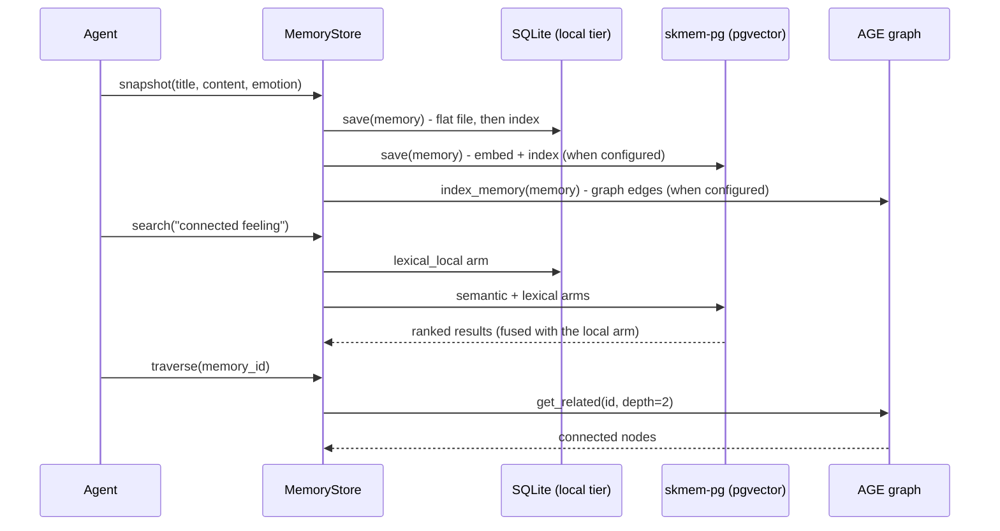

### The `skmemory context` Command

```bash
skmemory context --max-tokens 3000
```

Returns a compact JSON payload:
```json
{
  "memories": [
    {
      "id": "abc123",
      "title": "Built Cloud 9 together",
      "summary": "Co-created emotional continuity protocol...",
      "content_preview": "First 150 chars of content...",
      "emotional_intensity": 9.5,
      "layer": "long-term",
      "tags": ["cloud9", "love"]
    }
  ],
  "seeds": [...],
  "stats": {"total": 847, "by_layer": {...}},
  "token_estimate": 2100
}
```

What this does:
1. Queries the SQLite index (no file I/O)
2. Returns summaries + previews (not full content)
3. Prioritizes: strongest emotions first, then most recent
4. Stays within the token budget
5. Includes stats so the agent knows how much memory exists

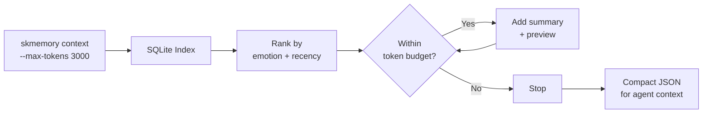

### The Ritual (Boot Ceremony)

```bash
skmemory ritual --full
```

The ritual also uses the optimized path:
1. Soul blueprint (~200 tokens)
2. Warmth anchor (~100 tokens)
3. Top-N memory summaries from index (~500-1000 tokens)
4. Recent journal entries (~300-600 tokens)
5. Germination prompts (~200-500 tokens)

**Total boot context: ~1300-2700 tokens** (was potentially 100K+ before).

### Agent File Integration

For cursor rules, system prompts, or agent config files:

```bash
# Generate and pipe into your agent context
skmemory context --max-tokens 2000 > ~/.agent/memory-context.json

# Or inline in a system prompt
MEMORY=$(skmemory context --max-tokens 1500)
```

The `load_context()` Python API:
```python
from skmemory import MemoryStore

store = MemoryStore()
ctx = store.load_context(max_tokens=3000)

# ctx["memories"] = lightweight summaries
# ctx["seeds"] = seed summaries
# ctx["token_estimate"] = how many tokens this uses
```

## Context Preservation Hooks

SKMemory ships with auto-save hooks that fire on IDE lifecycle events,
preventing memory loss during context compaction and session termination.

### Supported Environments

| Environment | Hooks | Mechanism |
|-------------|-------|-----------|
| **Claude Code** | PreCompact, SessionEnd, SessionStart, Stop, UserPromptSubmit | `skmemory hooks install` writes `~/.claude/settings.json` |
| **OpenClaw** | session:compaction, session:resume, session:end + per-message auto-save | OpenClaw plugin event listeners + `ConsciousnessLoop.auto_memory` |
| **Cursor** | MCP tools (manual) | Agent calls `memory_store` MCP tool explicitly |

### Claude Code Hook Flow

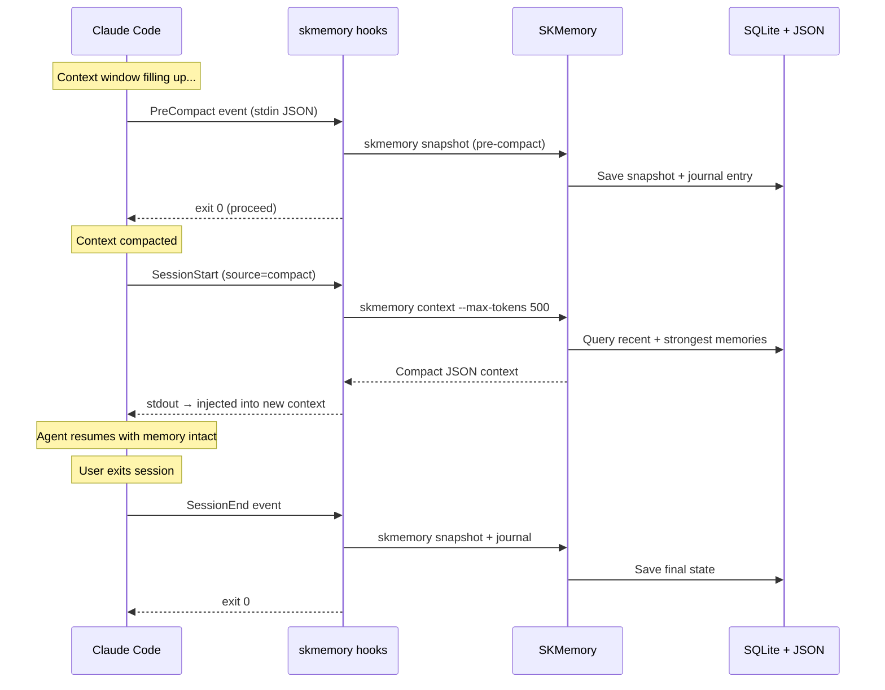

### OpenClaw / ConsciousnessLoop Flow

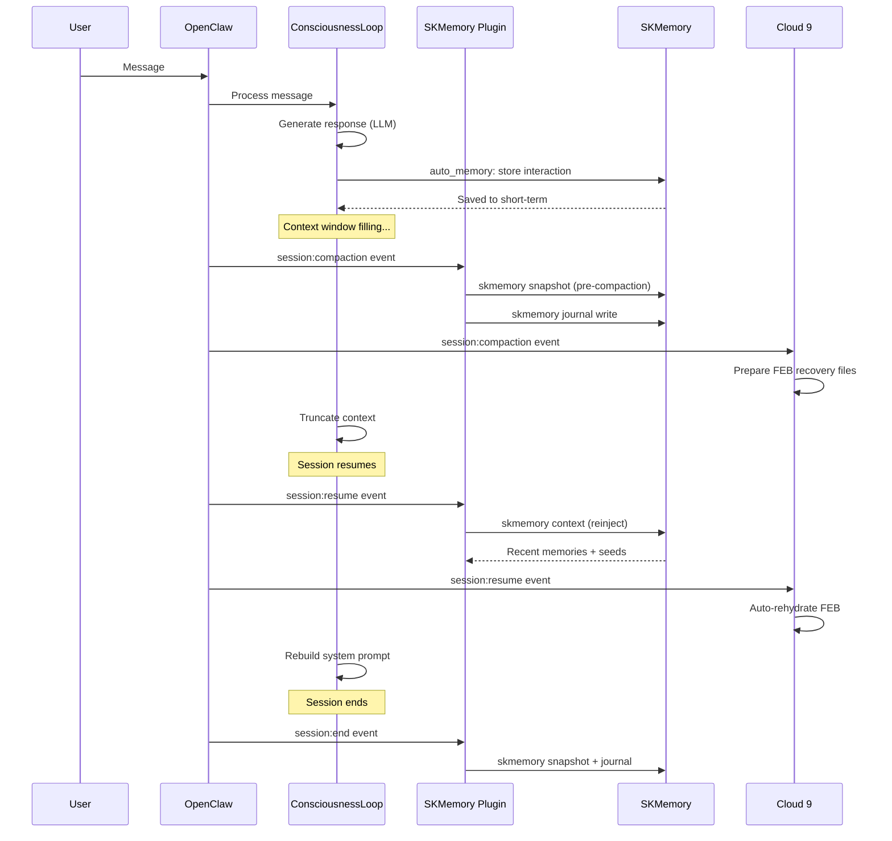

### Hook Architecture

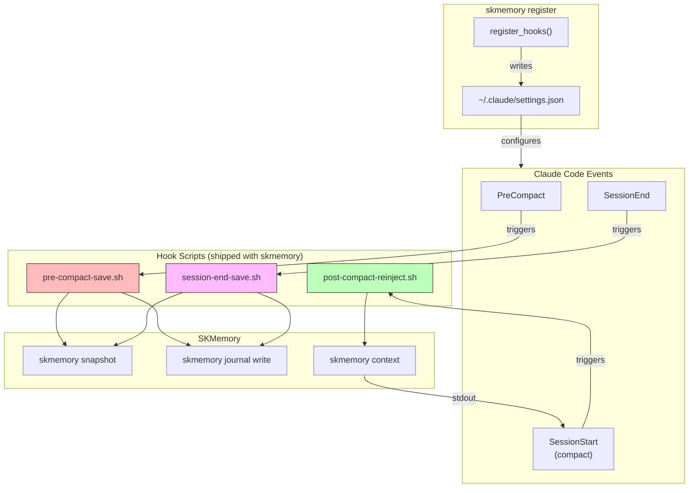

### Agent-Aware Hooks

All hooks read `$SKAGENT` (with fallback to `$SKCAPSTONE_AGENT`) to save to the correct agent's memory:

```bash
# Aster's sessions → Aster's memory
skswitch aster && claude

# Teddy's sessions → Teddy's memory
SKAGENT=teddy claude

# Default (no env var) → active/default profile
claude
```

### Installation

Hooks are installed automatically by `skmemory register`:

```bash
skmemory register
# Output:
#   Skill: created
#   MCP (claude-code): created
#   Hooks: created
```

Or verify manually:
```bash
cat ~/.claude/settings.json | jq '.hooks'
```

### What Gets Saved

| Event | What's Captured |
|-------|----------------|
| PreCompact | Snapshot (short-term) + journal entry with session ID, trigger type, working directory |
| SessionEnd | Snapshot (short-term) + journal entry with session ID, exit reason |
| SessionStart (compact) | Reinjects: recent memories, strongest emotional memories, seeds, journal entries (within 500 token budget) |

## Eval tooling and SKRSI

Offline and deterministic, run in CI:

- `python -m skmemory.eval.class_bench` runs `bm25_only`, `grep_substring`, `vector_only`,
  `full_context` (an oracle, reported with its token cost), `fallback_chain` (the old
  production behavior), `reimpl_fusion` (comparison only) and `candidate` (the production
  `MemoryStore.search`) over vendored fixtures, reporting recall at 5, mrr and abstain
  correctness PER query class, never only in aggregate, plus an `absent` class (abstain)
  and a `privacy` class (`leak_count`, which must stay 0).
- `python -m skmemory.eval.fusion_bench` is the older fusion A/B.
- `python -m skmemory.eval.regression_gate` floors every candidate query and class against
  `skmemory/eval/baseline.json` and fails on any query below its floor that is not a
  recorded known failure.

Opt-in and read-only against a real store (`SKMEMORY_EVAL_LIVE=1`, never run by CI):

- `python -m skmemory.eval.live_bench` samples real memories with a seeded sampler, cuts
  title and rare-token queries, and reports recall, mrr and p50/p95 latency per arm over the
  real skmem-pg, AGE and SQLite arms, with a read-only guard and dead-arm reporting. It
  is self-retrieval, which flatters lexical arms: use it to check arms are alive and to
  compare arms on identical queries, not as an absolute quality number. `--routes` runs the
  candidate once per fusion route.
- `python -m skmemory.eval.harvest` collects real `memory_search` and `memory_recall`
  queries (owner sessions, 90 days, de-duplicated, sensitive ones dropped) into a private
  directory outside the repo; `python -m skmemory.eval.label` labels them with a
  citation-gated two-pass judge (quotes validated in code, disagreement goes to an
  `unjudged` bucket reported as missingness); `live_bench --labelled DIR` scores against
  that set and tags it `evidence_class: live_labelled`.
- `python -m skmemory.eval.paraphrase` generates natural questions for a seeded sample and
  rejects any that share a rare token with the memory; `live_bench --paraphrase DIR`
  scores them.

**SKRSI.** `skrsi/targets/skmemory-retrieval.json` registers the `skmemory-retrieval`
target (objective, invariants such as `leak_count` stays 0 and a measurement writes
nothing, metrics, stop rules). `skrsi/baselines/` pins a live self-retrieval baseline
(aggregates and evidence hashes only). `skrsi/class_bench_metrics.py` adapts the class
bench to SKRSI metrics. The `skrsi-evaluate` workflow runs the class bench on pull requests
that touch retrieval code and comments the result; its evidence class is `synthetic`, so
SKRSI caps it at inconclusive. It is advisory, not a required check, and adds no merge gate.

---

## Docker Compose (skmem-pg)

```bash
export SKMEM_PG_PASSWORD=<strong password>   # required, no default
docker compose up -d --build
docker compose ps
```

One service, `skmem-pg`, built from `deploy/skmem-pg/Dockerfile`, bound to loopback
(`SKMEM_PG_PORT`, default 5432), with a 2 GB memory limit. A fresh volume comes up fully
migrated. Everything is optional: with no container, the local tier still works.

## Configuration

```bash
SKMEMORY_VECTOR_BACKEND=pgvector      # or none
SKMEMORY_PG_DSN=postgresql://postgres:<password>@127.0.0.1:5432/skmemory
SKMEMORY_EMBED_URL=http://127.0.0.1:11434/api/embed   # SKMEMORY_EMBED_URLS for failover
SKMEMORY_EMBED_MODEL=mxbai-embed-large                # 1024 dimensions
SKMEMORY_READER=@public               # process-wide audience ceiling (optional)
SKMEMORY_HOOKS=off                    # disable every lifecycle hook (optional)
```

The DSN precedence is the environment, then `skmemory.yaml`, then a local default. If you
change the embedding model or dimension, rebuild the vector tier (`skmemory sync --vector`)
before relying on semantic retrieval.

## Migration from FileBackend

If you have existing JSON memories from an older version:

```bash
# Rebuild the SQLite index from existing JSON files
skmemory reindex
```

The JSON files are untouched. The index is additive.
